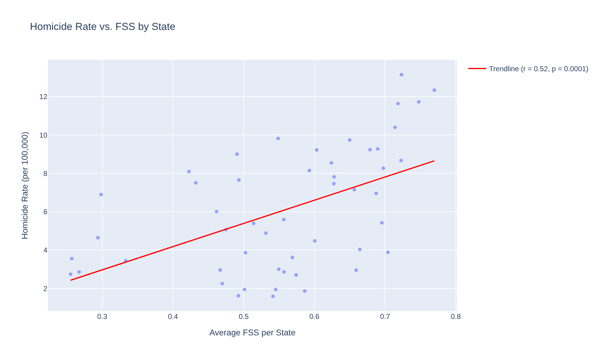
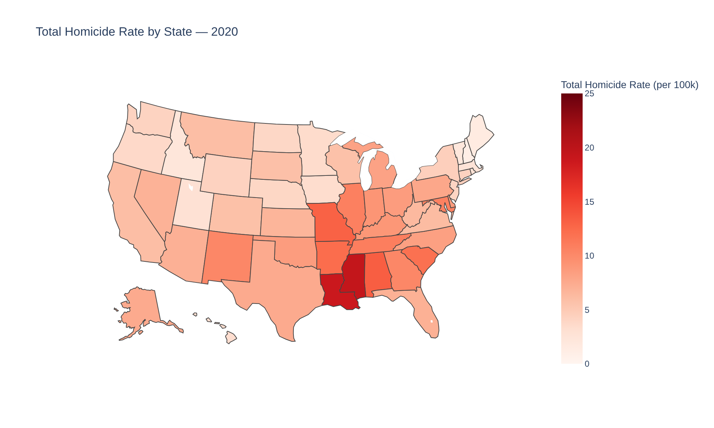
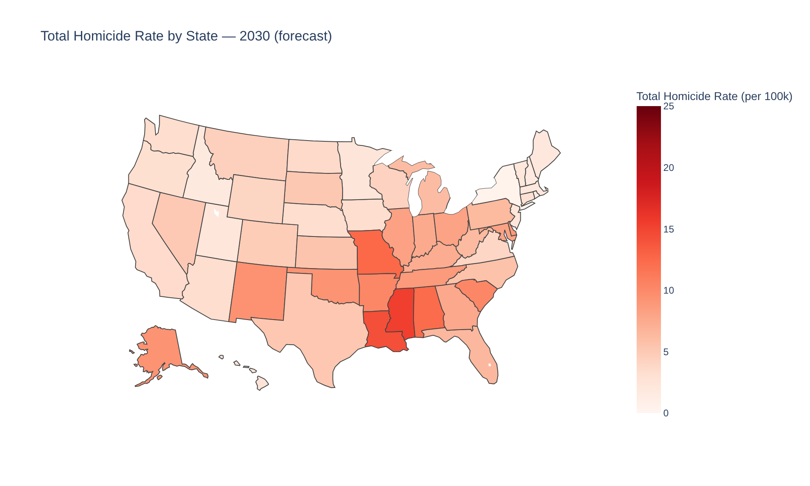

# Firearm Availability & Lethal Violence in the U.S. — Data Analysis

Team project for the **Introduction to Data Analysis** course, Industrial Engineering and Management, Ariel University.

The project explores how household firearm availability relates to homicide and suicide rates across U.S. states between 1949 and 2020.

---

## Data

- **Source:** "State-level household gun ownership proxy dataset, 1949–2020" (Kang & Rasich, 2023), via [Kaggle](https://www.kaggle.com/datasets/williecosta/firearm-suicide-rates-1949-2020?resource=download). Original data from the CDC.
- **Size:** 3,651 rows × 18 columns (50 states + DC, one row per state per year).
- **Key measure: FSS (Firearm Suicide Share).** The share of suicides committed with a firearm. It is a widely used *indirect proxy* for household gun ownership.

## Research Questions

1. Is firearm availability (FSS) associated with homicide rates, over time and across states?
2. Is firearm availability associated with overall suicide rates across states?
3. How do homicide rates differ between U.S. regions and states, and what do simple trend projections suggest for 2025–2030?

## Approach

1. **Data cleaning:** fixed data types, checked for missing values, and identified problematic rows.
2. **Exploratory analysis:** yearly trends, a correlation heatmap, and per-state averages.
3. **Statistical testing:** Pearson correlations with p-values, both over time and across states.
4. **Outlier handling:** District of Columbia was excluded from the state-level analysis as an extreme outlier.
5. **Group comparison:** states above vs. below the median FSS (box plots).
6. **Trend projection:** a simple linear trend per state (2000–2020 data), extended to 2025–2030.

## Key Findings

- **Across states**, higher FSS is associated with higher homicide rates (r = 0.52, p < 0.001, excluding DC).
- **Across states**, higher FSS is associated with higher overall suicide rates (r = 0.47, p ≈ 0.0005).
- **Over time**, yearly averages of FSS and homicide rates moved together (r = 0.85). However, both series share long-term trends, so this number overstates the relationship. The state-level analysis provides a more informative comparison across states.
- **Geographic gaps are large.** Mississippi and Louisiana were among the states with the highest average homicide rates in the analysis, while Maine, Vermont and New Hampshire were among the lowest.

| 2020 | 2030 (linear trend projection) |
|---|---|
|  |  |

## Limitations

- **Correlation, not causation.** The analysis shows associations only. Factors such as income, urbanization and policy were not controlled for.
- **FSS is an indirect proxy** for gun ownership, and it is partly derived from suicide data. This should be kept in mind when interpreting the suicide results.
- **The 2025–2030 projections** are simple linear trends per state, not validated forecasting models.

## Tools

Python, Pandas, NumPy, SciPy, scikit-learn, Matplotlib, Seaborn, Plotly.

## How to Run

Open `24.ipynb` in Jupyter Notebook or Google Colab and run all cells. The notebook loads `data1.csv` directly from this repository. The analysis narrative inside the notebook is written in Hebrew.

## Authors

- Tamar Gurfinkel
- Naama Sapir
- Liav Shamama
